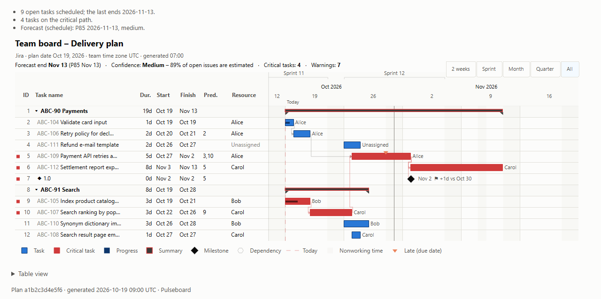
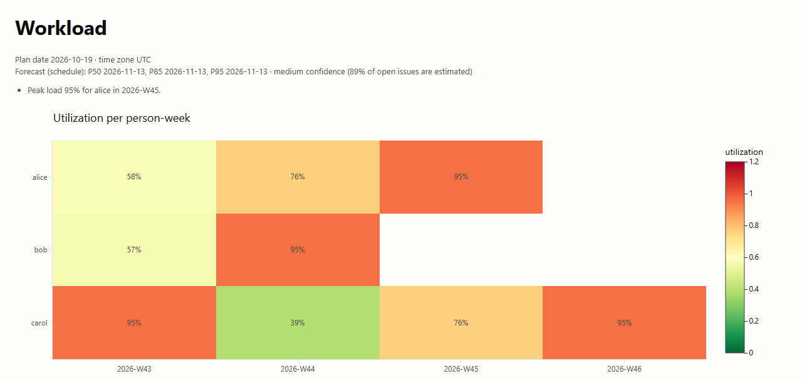

# Pulseboard

[](LICENSE)


Project plans, forecasts and risk reports from your Jira boards, right inside your AI assistant's
chat.

Pulseboard is an [MCP](https://modelcontextprotocol.io) server that reads a Jira Scrum or Kanban
board and works out the plan: who does what, in which order, and when the work is likely to
finish. Ask in plain words in VS Code's chat or any AI client that supports MCP, and you get
answers, charts and files back. It is built for project and program managers who want a realistic
finish date and the risks behind it without maintaining a separate plan by hand.

Pulseboard only reads Jira and never changes anything there. Every number comes from fixed
calculations, not from the AI, so the same board on the same day always gives the same result.

> **Status:** pre-release (version 0.1.0). Everything in the how-to sections below works today.
> Planned features are listed separately under [Coming soon](#11-coming-soon).

## Screenshots

**Gantt chart with the critical path.** Red bars are critical: if they slip, the end date slips.
Diamonds are milestones, and lines show which task waits for which.



**Workload heatmap.** One row per person, one column per week, from green (light load) to red
(100% and over).



## Features

- **Plan:** Gantt chart, critical path, dependency map, milestones at risk
- **People:** workload heatmap, who is over-allocated
- **Forecast:** finish dates (P50, P85, P95) with a confidence level, Monte Carlo chart
- **Flow:** cumulative flow, cycle time, throughput, aging work, burn-up
- **Health:** status summary, warnings and risks
- **Exports:** Excel, CSV, HTML and JSON
- **Jira Cloud and Data Center**, Scrum and Kanban boards
- **Two ways to run it:** connect to a shared corporate server, or run it on your own computer
- **Read-only and private:** uses your own Jira token, so it sees only what you can see

## Example

You type:

```text
Use Pulseboard to plan this board: https://yourcompany.atlassian.net/jira/software/projects/ABC/boards/42
```

Pulseboard answers (this answer comes from its built-in sample board):

> Forecast end: 13 Nov 2026, medium confidence (78% of open issues are estimated).
> 9 open issues, 4 on the critical path, 11 warnings. For example: "ABC-108 is blocked by XYZ-7,
> not on the board" and "ABC-111 has no estimate; default effort used."

[Everyday tasks](#7-everyday-tasks) lists what to type for every report.

## Contents

1. [What you need](#1-what-you-need)
2. [Choose how to use it](#2-choose-how-to-use-it)
3. [Get your Jira token](#3-get-your-jira-token)
4. [Option A: connect to the corporate server](#4-option-a-connect-to-the-corporate-server)
5. [Option B: run it on your computer](#5-option-b-run-it-on-your-computer)
6. [Your first Gantt chart](#6-your-first-gantt-chart)
7. [Everyday tasks](#7-everyday-tasks)
8. [Understanding the results](#8-understanding-the-results)
9. [Troubleshooting](#9-troubleshooting)
10. [Questions and answers](#10-questions-and-answers)
11. [Coming soon](#11-coming-soon)
12. [For administrators and developers](#12-for-administrators-and-developers)
13. [Build the Docker image](#13-build-the-docker-image)

---

## 1. What you need

- [ ] A Jira account that can open the board in your web browser.
- [ ] The board's link. Open the board in your browser and copy the address bar.
- [ ] A Jira token (step-by-step in [section 3](#3-get-your-jira-token)):
  - **Jira Cloud** (your Jira address ends in `.atlassian.net`): an **API token**.
  - **Jira Data Center or Server** (your organization's own Jira address): a **personal access token**.
- [ ] Any AI client that supports MCP: **VS Code** with its chat (recommended), or another AI
  client of your choice.
- [ ] For Option A: the server address and an access key from your Pulseboard administrator.
- [ ] For Option B: permission to install a small program (uv) on your computer.

**Board links that work** (copy them from your browser):

| Jira | Link looks like |
|---|---|
| Cloud | `https://yourcompany.atlassian.net/jira/software/projects/ABC/boards/42` |
| Data Center | `https://jira.yourcompany.com/secure/RapidBoard.jspa?rapidView=42` |

Any link that contains `/boards/<number>` also works, for example a board's backlog or timeline page.

## 2. Choose how to use it

| | **A. Corporate server** (easiest) | **B. On your own computer** |
|---|---|---|
| What you install | Nothing, except your AI app | Your AI app and one small program (uv) |
| Setup time | About 5 minutes | About 15 minutes |
| Where your token goes | Sent with each request to the corporate server, used for that request only, never stored | Stays on your computer, in Windows Credential Manager or the macOS Keychain |
| Which Jira | The one Jira site the server is set up for | Any Jira sites you add |
| How long results last | Up to 1 hour; download links work for 15 minutes | Stored on your computer; exported files open for 7 days |
| Needs the corporate server | Yes | No |

Both options give you the same reports. If you are unsure, start with **A**.

## 3. Get your Jira token

A token is a password-like code that lets Pulseboard read Jira as you. Pulseboard sees only what
you can already see in Jira.

### Jira Cloud: API token

1. Open <https://id.atlassian.com/manage-profile/security/api-tokens> and sign in.
2. Select **Create API token**.
3. Name it `Pulseboard`.
4. Set an **expiry date**. 90 days is a good choice.
5. Select **Create**.
6. Select **Copy**. Atlassian shows the token only once.
7. Paste it only where sections 5 or 6 tell you to.

> Use **Create API token**, not "Create API token with scopes". Scoped tokens have not been tested
> with Pulseboard yet. Pulseboard only ever reads, whichever token you use.

### Jira Data Center or Server: personal access token

1. Sign in to Jira in your browser.
2. Select your profile picture (top right), then **Profile**.
3. Select **Personal Access Tokens**.
4. Select **Create token**.
5. Name it `Pulseboard`.
6. Turn on **Automatic expiry** and choose 90 days.
7. Select **Create**, then copy the token. Jira shows it only once.

If you don't see **Personal Access Tokens**, ask your Jira administrator.

### What not to do

- **Never paste a token into the chat** with your AI assistant.
- Never put a token in an email, a chat message to a colleague, a shared document or any file.
- Never share your token with a colleague. Each person uses their own.
- If a token may have leaked, delete it on the same page where you made it, then create a new one.

## 4. Option A: connect to the corporate server

### Before you start

Ask your Pulseboard administrator for two things:

| You need | Looks like | Where to get it |
|---|---|---|
| Server address | `https://<server-address>/mcp` | Ask your Pulseboard administrator: `<administrator contact>` |
| Access key | A long code | Ask your Pulseboard administrator: `<access key process>` |

The access key lets you reach the server. Your Jira token is separate and stays yours.

### VS Code (recommended)

VS Code asks for your access key and token once and keeps them in its encrypted storage. The
settings file holds no secrets.

1. Open VS Code.
2. Press `Ctrl+Shift+P` (macOS: `Cmd+Shift+P`). The Command Palette opens.
3. Type `MCP: Open User Configuration` and press Enter. A file called `mcp.json` opens.
4. Replace everything in the file with the box below for your Jira type. If the file already lists
   other servers, add only the `pulseboard` part inside `"servers"` and the three `inputs`.
5. Replace `https://<server-address>/mcp` with the address from your administrator.
6. Save the file (`Ctrl+S`, macOS: `Cmd+S`).

**Jira Cloud:**

```json
{
  "inputs": [
    { "id": "pb-access-key", "type": "promptString", "description": "Pulseboard access key", "password": true },
    { "id": "jira-email", "type": "promptString", "description": "Atlassian account email" },
    { "id": "jira-token", "type": "promptString", "description": "Jira API token", "password": true }
  ],
  "servers": {
    "pulseboard": {
      "type": "http",
      "url": "https://<server-address>/mcp",
      "headers": {
        "X-Pulseboard-Access-Key": "${input:pb-access-key}",
        "X-Jira-User-Email": "${input:jira-email}",
        "X-Jira-Api-Token": "${input:jira-token}"
      }
    }
  }
}
```

**Jira Data Center:**

```json
{
  "inputs": [
    { "id": "pb-access-key", "type": "promptString", "description": "Pulseboard access key", "password": true },
    { "id": "jira-pat", "type": "promptString", "description": "Jira personal access token", "password": true }
  ],
  "servers": {
    "pulseboard": {
      "type": "http",
      "url": "https://<server-address>/mcp",
      "headers": {
        "X-Pulseboard-Access-Key": "${input:pb-access-key}",
        "X-Jira-Pat": "${input:jira-pat}"
      }
    }
  }
}
```

**Start the server:**

1. Press `Ctrl+Shift+P` (macOS: `Cmd+Shift+P`).
2. Type `MCP: List Servers` and press Enter.
3. Select **pulseboard**, then **Start Server**.
4. VS Code asks for each value in turn. Paste your access key, email (Cloud only) and token.

**Check that it's connected:**

1. Run `MCP: List Servers` again. **pulseboard** shows as running.
2. Open the Chat view and choose **Agent** mode.
3. Type: `Which Jira sites can Pulseboard see?` The answer names your corporate Jira.

### Any other AI client

Some AI clients start only programs on your own computer and read their MCP servers from a
settings file with an `mcpServers` section. They reach the corporate server through a small helper
called `mcp-remote`.

> **Warning:** with this setup your token is kept in plain text in your user account's settings.
> Anyone signed in to your computer as you could read it. Use VS Code if you can.

These steps are for Windows. On macOS, desktop apps don't see values set this way; use VS Code or
[Option B](#5-option-b-run-it-on-your-computer) instead.

1. Install **Node.js** (the LTS version) from <https://nodejs.org>. The helper needs it.
2. Open the Start menu and type `environment variables`. Select
   **Edit environment variables for your account**.
3. Under **User variables**, select **New** and add each of these, one at a time:

   | Variable name | Value |
   |---|---|
   | `PB_ACCESS_KEY` | your access key |
   | `JIRA_EMAIL` | your Atlassian email (Cloud only) |
   | `JIRA_TOKEN` | your API token (Cloud) or personal access token (Data Center) |

4. Select **OK**.
5. Open your app's MCP settings file. The app's help explains where to find it.
6. Add the `pulseboard` entry from the box below for your Jira type inside `"mcpServers"`, and
   replace `https://<server-address>/mcp`. Copy the lines exactly: there is no space after the
   colons inside the quotes.
7. Save the file.
8. Quit the app completely (right-click its icon near the clock, then **Quit**) and open it again.

**Jira Cloud:**

```json
{
  "mcpServers": {
    "pulseboard": {
      "command": "npx",
      "args": [
        "-y", "mcp-remote", "https://<server-address>/mcp",
        "--header", "X-Pulseboard-Access-Key:${PB_ACCESS_KEY}",
        "--header", "X-Jira-User-Email:${JIRA_EMAIL}",
        "--header", "X-Jira-Api-Token:${JIRA_TOKEN}"
      ]
    }
  }
}
```

**Jira Data Center:**

```json
{
  "mcpServers": {
    "pulseboard": {
      "command": "npx",
      "args": [
        "-y", "mcp-remote", "https://<server-address>/mcp",
        "--header", "X-Pulseboard-Access-Key:${PB_ACCESS_KEY}",
        "--header", "X-Jira-Pat:${JIRA_TOKEN}"
      ]
    }
  }
}
```

To check it's connected, type in a new chat: `Which Jira sites can Pulseboard see?`

## 5. Option B: run it on your computer

> **Before the first public release:** Pulseboard is not yet published for download. Until it is,
> ask your administrator how to install it: `<pre-release install instructions>`. The commands
> below are the ones you will use once it is published.

### Step 1: install uv

uv is a small program that downloads and runs Pulseboard for you. You install it once.

**Windows:**

1. Open the Start menu, type `PowerShell` and open **Windows PowerShell**.
2. Copy this line, paste it into the window and press Enter:

   ```powershell
   powershell -ExecutionPolicy ByPass -c "irm https://astral.sh/uv/install.ps1 | iex"
   ```

3. Close the PowerShell window and open a new one.

**macOS or Linux:**

1. Open the **Terminal** app.
2. Paste this line and press Enter:

   ```sh
   curl -LsSf https://astral.sh/uv/install.sh | sh
   ```

3. Close the Terminal window and open a new one.

**Check it worked.** The commands from here on are the same on every system:

```powershell
uvx pulseboard --version
```

You see:

```text
pulseboard 0.1.0
```

The first run downloads Pulseboard and can take a minute or two.

### Step 2: add your Jira site

```powershell
uvx pulseboard site add
```

Pulseboard asks a few questions. Press Enter to accept the suggestion in `[brackets]`. Your token
is typed hidden: nothing appears on screen while you paste it. This is normal.

```text
Board or site URL: https://yourcompany.atlassian.net/jira/software/projects/ABC/boards/42
Base URL [https://yourcompany.atlassian.net]:
Deployment (cloud or datacenter) [cloud]:
Site ID [yourcompany]:
Check the deployment type by reading the site's public server info? [y/N]:
Added site 'yourcompany' to C:\Users\<you>\AppData\Local\pulseboard\pulseboard.toml.
Account email: you@yourcompany.com
Token:
Stored the credentials in the OS keychain (service 'pulseboard').
Run `pulseboard site test yourcompany` now? [Y/n]:
```

For Jira Data Center, Pulseboard also asks `Auth method (pat or anonymous) [pat]`. Press Enter
(`pat` means personal access token). It doesn't ask for an email.

Your token goes into Windows Credential Manager or the macOS Keychain, never into a file.

### Step 3: test the connection

If you answered yes to the last question, the test has already run. To run it again at any time
(use your site ID):

```powershell
uvx pulseboard site test yourcompany
```

A working setup shows `PASS` on every line:

```text
PASS  reachable: https://yourcompany.atlassian.net answers (Jira <version>)
PASS  deployment: site reports 'cloud'
PASS  sign-in: signed in as <your name>
PASS  time zone: <your time zone>
```

If a line says `FAIL`, see [Troubleshooting](#9-troubleshooting).

### Step 4: connect your AI app

Neither file below contains a token. Pulseboard reads it from your computer's keychain.

**VS Code:** press `Ctrl+Shift+P` (macOS: `Cmd+Shift+P`), run `MCP: Open User Configuration`, and
put this in `mcp.json`:

```json
{
  "servers": {
    "pulseboard": {
      "type": "stdio",
      "command": "uvx",
      "args": ["pulseboard", "serve"]
    }
  }
}
```

Then run `MCP: List Servers`, select **pulseboard** and **Start Server**.

**Any other AI client:** add this inside `"mcpServers"` in the client's MCP settings file. Then
quit and reopen the client.

```json
{
  "mcpServers": {
    "pulseboard": {
      "command": "uvx",
      "args": ["pulseboard", "serve"]
    }
  }
}
```

If the app says it can't find `uvx`, replace `"uvx"` with its full path. To find it, run
`where.exe uvx` (Windows) or `which uvx` (macOS, Linux). On Windows, write each `\` in the path as
`\\` inside the file.

### Handy commands

| To do this | Type | You see (example) |
|---|---|---|
| See where settings and data are kept | `uvx pulseboard config path` | `Settings file: ...` and `Data folder: C:\Users\<you>\AppData\Local\pulseboard` |
| Check the settings file | `uvx pulseboard config check` | `Settings OK: ...` (no network calls) |
| List your Jira sites | `uvx pulseboard site list` | One line per site, and where its token is kept |
| Remove a site | `uvx pulseboard site remove <site-id>` | Asks before deleting the stored token |
| Delete old data | `uvx pulseboard admin purge` | Deletes data older than the limits in [Questions and answers](#10-questions-and-answers) |

Before any site is added, the first three show:

```text
Settings file: none (no settings file found (looked for C:\Users\<you>\AppData\Local\pulseboard\pulseboard.toml))
Data folder: C:\Users\<you>\AppData\Local\pulseboard

Settings OK: defaults (no settings file), 0 sites.
No Jira sites are configured, so no remote calls are made. Run `pulseboard site add`.

No sites configured. Run `pulseboard site add`.
```

> **Jira that requires a client certificate:** not supported yet. See [Coming soon](#11-coming-soon).

## 6. Your first Gantt chart

1. Open your board in the browser and copy the link from the address bar.
2. In VS Code's chat (in **Agent** mode) or in your AI client, type:

   ```text
   Use Pulseboard to plan this board and make a Gantt chart: <paste your board link>
   ```

3. Wait while Pulseboard reads the board. A large board can take a minute or two.
4. The assistant answers with the forecast end date, the confidence, the number of critical tasks
   and the top warnings.
5. Open the chart:
   - **Option A (corporate server):** the assistant gives you a download link. Open it within
     **15 minutes**. After that, ask for the chart again.
   - **Option B (your computer):** the chart is saved as an `.html` file in your data folder.
     Run `uvx pulseboard config path` and open the **Data folder** it shows. Open the `exports`
     folder, then the folders inside it (one for your site, one inside that), until you see
     `.html` files. The newest one is your chart. Double-click it to open it in your browser.

Your chart looks like the Gantt chart under [Screenshots](#screenshots).

### What the chart shows

The left side is a table of tasks. The right side is the timeline. Rows line up across both.

| You see | It means |
|---|---|
| Blue bar | A task, from its planned start to its planned finish |
| Red bar, with a small red square in the table | A **critical task**: if it slips, the end date slips |
| Darker band inside a bar | Progress made so far |
| Thin bracket bar over a group | Summary of an epic (or a person), from first start to last finish |
| Diamond ◆ | A **milestone**: a release date (fix version) or an epic's due date. A ⚑ label shows how many days late the forecast is |
| Line with an arrowhead | A **dependency**: the task at the arrow waits for the other one. Red when on the critical path |
| Red dashed vertical line, "Today" | The plan date |
| Grey dashed "P50" and dotted "P85" lines | The forecast range (shown for Kanban boards and low-confidence plans; see [section 8](#8-understanding-the-results)) |
| Grey shaded columns | Weekends and team holidays. Point at one to see the holiday's name |
| Small orange ▼ marker | The task is forecast to finish after its due date |

**Things you can do in the chart:**

- Point at a bar to see its details.
- Select a bar to open the issue in Jira.
- Use the buttons **2 weeks**, **Sprint**, **Month**, **Quarter** and **All** to change the time range.
- Select an item in the legend to hide or show it, for example the dependency lines.
- Open **Table view** under the chart to see the numbers.
- Use the camera icon to save a picture of the chart.

The chart follows your computer's light or dark mode. With more than 150 tasks, groups start collapsed.

## 7. Everyday tasks

Plan the board first (paste its link, as in section 6). Then ask follow-up questions in the same
chat. You can always paste the board link again.

| What to type | What you get |
|---|---|
| `Show the Gantt chart grouped by person` | The Gantt chart with one group per assignee. You can also ask for grouping by epic (the default) or no grouping, and for colors by issue type (the default) or by epic |
| `What is on the critical path?` | The critical tasks in order, with start, finish, assignee, and why each starts when it does: waiting for another task, for the person, for a release date, or for today |
| `Show the workload heatmap` | A grid of people by week. Each cell shows how full that person's week is, from green (light load) to red (100% and over). People are listed by their Jira account ID |
| `Who is over-allocated?` | The person-weeks planned above 100% |
| `What are the warnings and risks?` | Warnings counted by type, then the list. You can ask for only errors, only warnings, or one type, such as `missing estimates` |
| `When will this board finish?` | Forecast dates P50, P85 and P95, the method used and the confidence, with the reason |
| `When will release 2.0 finish?` | The same forecast for one fix version or epic. It works for fix versions with a release date and epics with a due date |
| `Which milestones are at risk?` | Each milestone's target date, forecast date and slip in working days |
| `Give me a status summary` | Counts of To do, In progress, Done and Blocked, the forecast against the target date, and milestones at risk |
| `Show cumulative flow` | A chart of how many issues sat in each board column, day by day |
| `Show cycle time and throughput for the last 30 days` | How long issues take from start to done (P50 and P85), and how many finish each week |
| `Which items are aging?` | Items in progress longer than most items take (longer than the cycle-time P85) |
| `Show the burn-up chart` | Scope and done work over time, for the current sprint (Scrum) or a date window (Kanban) |
| `Show the Monte Carlo forecast` | A chart of the simulated finish dates |
| `Show the dependency map` | The "blocks" links between issues, with blockers outside the board marked |
| `Export the workload as Excel` | A file to download or open. Formats: **Excel** (.xlsx), **CSV** (a .zip when there are several tables), **HTML** and **JSON**. Any chart above can be exported |

[Screenshots](#screenshots) shows an example workload heatmap.

**Not available today:**

- Filtering the Gantt chart to certain people or epics. Grouping by person or epic works.
- PDF export.
- JQL queries, saved filters or lists of issue keys. Pulseboard works from board links only. To
  report on a set of issues, use a board whose filter selects them.

## 8. Understanding the results

### Forecast and confidence

Pulseboard forecasts in one of two ways and tells you which one it used.

- **Schedule.** When at least 60% of the open issues have an estimate, Pulseboard plans each task
  around people, dependencies and the work calendar. You get one finish date.
- **Monte Carlo.** When fewer issues are estimated, Pulseboard uses how many issues the team
  finished each week in the past and simulates 10,000 possible futures. You get a range:
  - **P50:** half of the simulated futures finish by this date.
  - **P85:** 85 in 100 finish by this date. A safer date to commit to.
  - **P95:** 95 in 100 finish by this date.

**Why Kanban boards often show a range:** Kanban teams often don't estimate, so the Monte Carlo
method is used. A range is the honest answer when the size of the work is unknown.

**Confidence** is high, medium or low, always with a reason:

| Confidence | When |
|---|---|
| High | Schedule, with at least 90% of open issues estimated |
| Medium | Schedule with 60 to 89% estimated, or Monte Carlo with at least 4 weeks of history |
| Low | Schedule with under 60% estimated, Monte Carlo with under 4 weeks of history, or no schedule could be found |

### "Sequence view"

When the Monte Carlo method is used, the Gantt chart shows a banner such as
`Sequence view: 40% of open work estimated (under 60%) – use the forecast range`, and in some
views the title `Sequence view: low confidence`. The **order** of the tasks is still useful.
The **dates** on the bars are rough. Use the P50 and P85 dates instead.

### Warnings

Each warning has an ID, a level (error, warning or info) and a message that names the issues.

| ID | Level | What it means | What you can do |
|---|---|---|---|
| `W001_cycle` | Error | Issues block each other in a loop. One link was ignored | Fix the "blocks" links in Jira |
| `W002_external_blocker` | Warning | An issue is blocked by an issue that is not on this board | See [External blockers](#external-blockers) |
| `W003_missing_estimate` | Warning | No estimate; a default of one day was used | Add an estimate |
| `W004_invalid_estimate` | Warning | The estimate could not be read | Check the estimate value |
| `W005_unassigned` | Warning | No assignee | Assign it |
| `W006_due_date_miss` | Warning | Forecast to finish after its due date | Re-plan, or move the due date |
| `W007_sprint_spill` | Warning | Forecast to finish after its sprint ends | Re-plan the sprint |
| `W008_overallocation` | Warning | A person is planned above 100% in a week | Move or reassign work |
| `W009_blocked_in_progress` | Warning | In progress, but waiting on an open blocker | Unblock it first |
| `W010_milestone_risk` | Warning | A release or epic is forecast late | Cut scope or move the date |
| `W011_low_confidence` | Info | Too few issues are estimated; the Monte Carlo forecast is used | Estimate more issues for a schedule forecast |
| `W012_solver_wallclock_cap` | Warning | Planning hit its time limit; the plan may differ slightly between runs | Use a smaller board, or ask again |
| `W013_stale_plan` | Warning | Jira can't be reached; you are seeing an older plan (Option B only) | Try again later |
| `W014_aging_wip` | Info | In progress much longer than usual | Check whether it is stuck |

### External blockers

Pulseboard plans only the issues on the board you gave it. If an issue is blocked by an issue on
another board or in another project, Pulseboard can't plan that other issue. It shows the link as
an external blocker (`W002_external_blocker`), and the dependency map draws it as a grey cross.
Ask the other team when it will be done, or add the blocking issue to your board.

### Dates and calendar

Plans use working days. By default, Pulseboard uses 8-hour days, US public holidays and the UTC
time zone. Your administrator (Option A) or the [configuration guide](docs/guides/configuration.md)
(Option B) can set your team's holidays, time zone, capacity and leave.

## 9. Troubleshooting

Errors appear in the chat as one line: `<code>: <message> Hint: <what to do>`.

| You see | What it means | What to do |
|---|---|---|
| `auth_failed: Jira rejected the credentials for site '...'` | Jira did not accept your token | Your token may have expired or been mistyped. Create a new one ([section 3](#3-get-your-jira-token)). Option A: in VS Code, remove and add the server again so it asks anew. Option B: run `uvx pulseboard site add` again |
| `auth_failed: missing per-user Jira credentials` | Option A: the server did not get your email and token | Check that `mcp.json` has all the header lines from [section 4](#4-option-a-connect-to-the-corporate-server) |
| `auth_failed: No token configured for site '...'` | Option B: no token is stored for this site | Run `uvx pulseboard site add` |
| `site_not_configured: '...' is not a configured Jira site.` | The link is not on a Jira site Pulseboard knows | Option A: the server serves one Jira site only; check with your administrator. Option B: add the site with `uvx pulseboard site add` |
| `invalid_board_link: The link has no board ID.` | The link is not a board link | Copy the link while the board is open in your browser |
| `permission_denied: The Jira user cannot see this board or resource.` | Your Jira account can't open this board | Ask the board owner for access |
| `board_not_found: Jira found no such board.` | The board doesn't exist or was deleted | Check the link |
| `plan_expired: This plan is unknown or has expired.` | The plan is no longer kept (after 1 hour or a restart on the corporate server) | Paste the board link again |
| `plan_expired: This export is unknown or has expired.` | The file is no longer kept | Ask for the chart or export again |
| `rate_limited: Jira is throttling requests. Retry after N s.` | Jira asked Pulseboard to slow down | Wait the number of seconds shown, then ask again |
| `board_too_large: The board has more than 2000 open issues.` | The board is too big to plan | Use a board with a narrower filter |
| `server_busy: The server is busy planning other boards.` | Corporate server only: other people are planning boards right now | Wait a moment and ask again |
| `timeout: Building the plan took too long.` | Planning took longer than the 2-minute limit | Try again later, or use a smaller board. You may still get flow metrics |
| `not_available: PDF export is not available on this server.` | Corporate server only: it does not make PDF files | Ask for HTML, Excel (xlsx), CSV or JSON instead |
| `jira_unavailable: Jira is unreachable or failing.` | Jira didn't answer | Check that Jira opens in your browser, then try again later |
| `401` with `Missing or invalid X-Pulseboard-Access-Key.` | Option A: the access key is missing or wrong | Remove and add the server in VS Code so it asks for the key again, or check `PB_ACCESS_KEY` for other AI clients. Ask your administrator if the key changed |
| Your Jira requires a **client certificate** | Not supported yet | Use the corporate server if your administrator offers one, or wait for this feature ([Coming soon](#11-coming-soon)) |
| `FAIL  sign-in: ...` from `site test` | Option B: the token or email is wrong | Run `uvx pulseboard site add` again with a new token |
| `FAIL  deployment: site reports '...'; the settings say '...'` | Option B: Cloud and Data Center were mixed up | Run `uvx pulseboard site remove <site-id>`, then `site add`, and choose the type the message names |
| Installing or downloading fails with `invalid peer certificate: UnknownIssuer` | Your corporate network checks secure connections | Add `--native-tls` after `uvx`, for example `uvx --native-tls pulseboard site add` |
| The AI app can't find `uvx` | The app doesn't know where uv is installed | Use the full path ([section 5, step 4](#step-4-connect-your-ai-app)) |
| Pulseboard tools don't appear in VS Code's chat | The chat is not in Agent mode, or the server is stopped | Choose **Agent** mode. Run `MCP: List Servers` and start **pulseboard** |

## 10. Questions and answers

**What data does Pulseboard keep, and for how long?**

- **Option A (corporate server):** nothing is written to disk. Board data, plans and exported files
  are kept in the server's memory for up to 1 hour, and are gone when the server restarts. Your
  Jira token is used for your request and then dropped. The server remembers who you are for
  10 minutes using a scrambled fingerprint of your credentials, never the token itself.
- **Option B (your computer):** data stays in your data folder (`uvx pulseboard config path`
  shows where). Board data is kept 365 days, plans 30 days and exported files 7 days.
  `uvx pulseboard admin purge` deletes anything older. Your token stays in your computer's keychain.

**Who can see my boards and reports?**

Only you. Pulseboard reads Jira with your own token, so it sees only what you can see in Jira. On
the corporate server, every plan and export is tied to your Jira account; if someone else asks for
it, they get `plan_expired`. A download link works for 15 minutes for anyone who has it, so don't
forward it. Send the downloaded file instead.

**Does Pulseboard change anything in Jira?**

No. It only reads. It never creates, edits or deletes anything in Jira.

**Why do links stop working after a while?** (corporate server)

Download links last 15 minutes and plans last up to 1 hour, so no copies of your data stay on the
server. Ask again and you get a fresh one.

**Does the AI work out the numbers?**

No. Pulseboard calculates every number itself. The AI assistant only passes on your question and
explains the answer.

**What's the difference between Jira Cloud and Data Center?**

| | Jira Cloud | Jira Data Center or Server |
|---|---|---|
| Address | Ends in `.atlassian.net` | Your organization's own address |
| What you need | Your Atlassian email and an API token | A personal access token (no email) |
| Reports | The same | The same |

## 11. Coming soon

> **These features are designed but not built yet.** They don't work today.

| Feature | What it will do |
|---|---|
| PDF export | Save any report as a PDF |
| Filters in charts | Show only certain people, epics, statuses, sprints, or only the critical path |
| Baseline comparison | Compare today's plan with an earlier one and show what slipped |
| What-if | Try changes, such as adding a person, and see the new end date |
| Program view | Plan up to 10 boards together with shared people |
| Client certificates | Connect to Jira sites that require a client certificate |
| History on the corporate server | Keep plans longer than 1 hour on the corporate server |
| Excel outline grouping | Collapsible epic groups in Excel exports |
| Risk log, financials and benefits | Reports from data kept outside Jira |

## 12. For administrators and developers

- [Configuration guide](docs/guides/configuration.md): settings file, sites, credentials, team calendar
- [Cloud Foundry deployment](deploy/cloudfoundry/): running the corporate server
- [Design](docs/DESIGN_2.md)
- [Contributing](CONTRIBUTING.md)
- [Security policy](SECURITY.md)
- [Build the Docker image](#13-build-the-docker-image): the image the corporate server runs

## 13. Build the Docker image

This is for administrators who run the corporate server (Option A). The image runs Pulseboard as
an HTTP server on port 8765. It has no Jira tokens, access keys or corporate certificates inside.

### What you need

- Docker with BuildKit (Docker Desktop includes it).
- This repository, checked out. Run every command below from its top folder.

### Step 1: build the image

Always build for `linux/amd64`, the platform Cloud Foundry runs:

```powershell
docker buildx build --platform linux/amd64 -f deploy/Dockerfile -t pulseboard:dev --load .
```

The first build downloads the base images and packages and takes a few minutes.

**If the build fails with a certificate error** (`invalid peer certificate: UnknownIssuer`), your
corporate network or antivirus checks secure connections. Make one PEM file that holds the
standard CA list (certifi) followed by your network's root certificate, and pass it to the build
as a secret. It is used only while building and is not copied into the image:

```powershell
docker buildx build --platform linux/amd64 -f deploy/Dockerfile -t pulseboard:dev --load --secret id=build_ca,src=<path-to-bundle.pem> .
```

### Step 2: check the image

The smoke test starts the image next to a stand-in Jira and checks that the server answers, that
it refuses requests without an access key, that it can plan a sample board, and that no token
appears in its log. It needs `openssl` and the development tools (`uv sync`):

```powershell
uv run python scripts/image_smoke.py --image pulseboard:dev
```

### Step 3: try it on your computer (optional)

```powershell
docker run --rm -p 8765:8765 -e PULSEBOARD_SITE_URL=https://yourcompany.atlassian.net -e PULSEBOARD_SITE_DEPLOYMENT=cloud -e PULSEBOARD_ACCESS_KEYS=<access-key> -e PULSEBOARD_PUBLIC_URL=http://127.0.0.1:8765 pulseboard:dev
```

| Setting | What it is |
|---|---|
| `PULSEBOARD_SITE_URL` | The one Jira site this server serves |
| `PULSEBOARD_SITE_DEPLOYMENT` | `cloud` or `datacenter` |
| `PULSEBOARD_ACCESS_KEYS` | One or more access keys, separated by commas. Each is at least 16 characters |
| `PULSEBOARD_PUBLIC_URL` | The address people use to reach the server. Download links start with it |

Open <http://127.0.0.1:8765/health> in your browser to check it is running. Then connect VS Code as
in [section 4](#4-option-a-connect-to-the-corporate-server), with `http://127.0.0.1:8765/mcp` as the
server address.

### Step 4: the corporate image

Released images are published as `ghcr.io/sunishbharat/pulseboard:<version>`. To push to your
corporate registry, wrap a released version with `deploy/Dockerfile.corp`. Give it an exact
version; `latest` is refused:

```powershell
docker buildx build --platform linux/amd64 -f deploy/Dockerfile.corp --build-arg BASE_TAG=<version> -t <corporate-registry>/pulseboard:<version> --load deploy
```

Your corporate root certificate is added only if the server can't reach Jira because of a
certificate error. See `deploy/corp-ca/README.txt`. Never commit certificate files.

To deploy the image, see [Cloud Foundry deployment](deploy/cloudfoundry/).

## License

[MIT](LICENSE)
